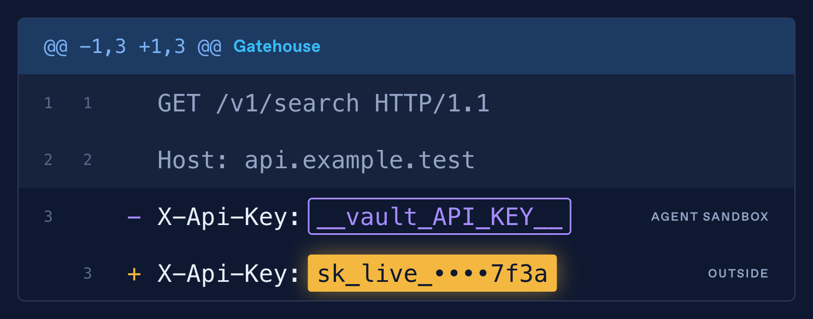
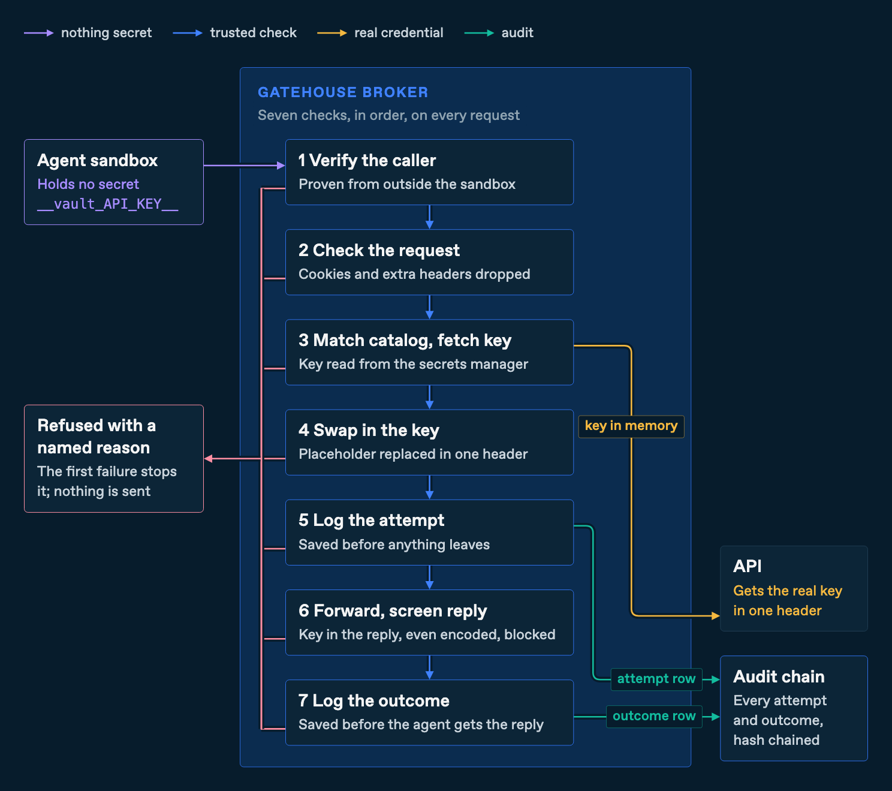

<p align="center">
  
</p>

<h1 align="center">Gatehouse</h1>

<p align="center"><strong>A credential proxy for AI agents. The agent holds a placeholder; Gatehouse adds the real credential on the way out.</strong></p>

<p align="center">
  <a href="#try-it-in-5-minutes">Try it</a> ·
  <a href="#how-it-works">How it works</a> ·
  <a href="#security-model">Security model</a> ·
  <a href="docs/gatehouse/developer-guide.md">Developer guide</a> ·
  <a href="SECURITY.md">Report a vulnerability</a>
</p>

<p align="center">
  <a href="https://github.com/trmlabs/trm-gatehouse/actions/workflows/ci.yml"></a>
  <a href="LICENSE"></a>
  
</p>

An AI agent that holds an API key, database password or token can be tricked
into leaking it. A file, web page or issue the agent reads can carry hidden
instructions, and no one has a reliable way to stop a model from following
them.

Gatehouse takes the credential out of the agent. The agent sends its request
with a placeholder where the credential would go. Gatehouse checks who is
calling and whether the destination is allowed, swaps in the real credential
from your secrets manager, and records the request in a tamper-evident audit
trail. A hijacked agent has nothing to leak, and anything the catalog does not
allow is refused.

> **Built on Infisical's Agent Vault.** Gatehouse is a fork of
> [Infisical/agent-vault](https://github.com/Infisical/agent-vault), MIT
> licensed. Its contributors built the proxy this project starts from, and we
> offer generic fixes back. Gatehouse is maintained by TRM Labs. It is not an
> Infisical product, and Infisical has not reviewed or endorsed it.

## Status

**Pre-release. Not yet recommended for production.** There is no tagged
Gatehouse release, and no version is supported for security fixes yet
([SECURITY.md](SECURITY.md)).

| Part | State |
|---|---|
| HTTP API keys, PostgreSQL logins and GitHub | Running in TRM's staging environment for two agent platforms. HTTP and PostgreSQL are also tested against a real secrets manager and database in the [local demo](#try-it-in-5-minutes) |
| Google Cloud and browser sign-in | Built and tested on `main` |
| Limiting an entry to people in named groups | Built. Off until a deployment turns on the directory lookup, which supports Microsoft Entra ID only |
| Upstream Agent Vault features (vaults, web UI, proposals, TypeScript SDK) | Inherited unchanged. Gatehouse's strict profile does not use them |
| Production | Not live |

## Try it in 5 minutes

One container brings a test secrets manager and a test PostgreSQL database,
runs with no network access, and proves the core behavior against them. You
need Docker and nothing else.

```sh
git clone https://github.com/trmlabs/trm-gatehouse && cd trm-gatehouse
docker build -f examples/credential-proxy/Dockerfile -t credential-proxy-verification .
docker run --rm --network none credential-proxy-verification
```

The build takes about a minute and a half and the run about three. The last
lines read:

```text
PASS: local HTTP and PostgreSQL fixtures.
Deployment acceptance still requires the actual runtime identity, encrypted ingress and bypass checks.
```

A nonzero exit is a failure. Some tests print a skip line asking for extra
settings; those cover setups the container does not include.

What the run proves:

- A placeholder is swapped for the real key only for the catalog's host, path and method. Everything else is refused.
- A key rotated in the secrets manager is used on the next request, and a deleted key is never sent.
- A reply that echoes the key back, in plain text or a common encoding, is cut off.
- Every attempt is recorded before the request leaves, and a dropped connection is recorded as an unknown outcome, never replayed.
- Every database connection gets a fresh login that is removed when it closes, even after the broker crashes.
- A broker that loses its own login to the secrets manager stops serving and closes running queries.

<details>
<summary>Behind a corporate proxy that inspects TLS?</summary>

The build downloads Go modules. If it fails with
`x509: certificate signed by unknown authority`, pass your proxy's CA
certificate to the build:

```sh
docker build --secret id=demo_ca,src=/path/to/proxy-ca.pem \
  -f examples/credential-proxy/Dockerfile -t credential-proxy-verification .
```

The certificate is used only during the build and is not kept in the image.
</details>

## How it works

<p align="center">
  
</p>

The agent runs with an ordinary proxy setting and connection string. Where a
credential would go, it sends a placeholder such as `__vault_API_KEY__`:

```sh
export API_KEY=__vault_API_KEY__   # all the agent ever holds
curl -H "X-Api-Key: $API_KEY" https://api.example.com/v1/search
```

Gatehouse runs seven checks in order, and the first failure stops the request
before anything reaches the destination:

1. **Verify the caller.** Something outside the sandbox proves which workload is calling, and when there is one, which person started it.
2. **Check the request.** Cookies and headers the entry does not expect are refused.
3. **Match the catalog and fetch the key.** The host, path and method must match an entry granted to the caller's pool.
4. **Swap in the key.** The placeholder is replaced in the one header the entry names.
5. **Log the attempt.** The audit record is written before anything leaves.
6. **Forward the request and screen the reply.** A reply that contains the key is cut off. Gatehouse does not follow redirects, so a credential never reaches a new host.
7. **Log the outcome.** The result is recorded before the agent gets the reply.

Every destination is one entry in one reviewed catalog. This is a whole entry
for an HTTP API:

```yaml
- name: catalog-search
  host: api.example.com
  pathPrefixes: [/v1/search]
  methods: [GET]
  header: X-Api-Key
  placeholder: __vault_API_KEY__
  key: {mount: gatehouse, path: vendors/catalog-search, field: key}
  pools: [research-agents]
```

The broker reloads the catalog every 30 seconds. A version that fails
validation never replaces the last good one, and the agent cannot widen an
entry; only the next reviewed change can. Check a catalog before you propose
it:

```sh
./agent-vault broker-catalog validate --require-pools catalog.yaml
```

## What agents can reach

| Destination | The agent sends | Gatehouse adds |
|---|---|---|
| HTTP APIs | A placeholder in the key header | The real key, for the entry's host, paths and methods only |
| PostgreSQL | A placeholder password | A fresh database login for each connection, removed when the connection closes |
| GitHub repositories (clone, push) | Nothing | A short-lived GitHub App token for one repository. Pushes can be limited to branch prefixes |
| GitHub pull requests, Actions and deployments | A placeholder token, or none | The same App token, limited to the operations the entry lists |
| Google Cloud Storage and BigQuery | A placeholder token | A short-lived token narrowed to one bucket prefix, or to one service account |
| Web apps that sign in with Auth0 | Nothing | A sign-in as a test or service account. The browser holds only placeholders, and cookies never pass |

## Who is calling

The agent holds nothing, so it cannot prove who it is. Something outside the
sandbox vouches for it instead, using tokens that Kubernetes and Cursor
already sign:

| Agent runtime | How it reaches Gatehouse | Who the audit names |
|---|---|---|
| Kubernetes Pods | A sidecar on the Pod's loopback address presents the Pod's own service account token. Gatehouse checks the live Pod, its owner and its exact image | The pool, or the person when the runtime signs a session token that names them |
| Shared sandbox clusters | A relay outside the sandboxes matches each connection to a live sandbox Pod. The sandbox holds no identity token at all | The person who started the sandbox, or the pool |
| Cursor self-hosted workers | The sidecar adds Cursor's short-lived token for the task, accepted only from the worker running that task | The person who started the task |

Each runtime is declared in the catalog as a harness. A new runtime is a new
catalog entry, and needs code only if it brings a new kind of identity proof.
See the [broker catalog reference](docs/gatehouse/broker-catalog.md).

## Security model

**What Gatehouse protects.** The credential. An agent that is fully under an
attacker's control still cannot read, copy or redirect a credential, because
the credential never enters its sandbox. Each attempt to get it back ends at a
check:

| The hijacked agent tries to | Stopped at |
|---|---|
| Send the placeholder to its own server | Catalog match: no entry for that host |
| Ask an approved API to echo the key back | Reply screening, in plain text or common encodings |
| Follow a redirect to a new host | Gatehouse does not follow redirects, and the new host needs its own entry |
| Use its own credential or a chosen database password | Refused. The database accepts connections only from Gatehouse |

**What it does not protect.** Whatever an approved destination sends back,
the agent can read. Grant each entry only what the agent's task needs. Gatehouse
is one layer: it assumes the sandbox's network is locked down so the agent can
reach destinations only through Gatehouse.

**Every failure ends in a refusal.**

- **Secrets manager unreachable.** A key read in the last minute keeps working for up to five more minutes, then every call is refused.
- **Audit storage unavailable.** The request is refused and nothing is sent.
- **Connection dropped mid-request.** The outcome is recorded as unknown and never replayed.
- **A database login may be left behind.** Gatehouse revokes it, and closes that database only if revocation fails. It reopens by itself once a later check is clean.

**Audit trail.** Every request and database session is one record in a
hash-chained log. Checkpoints are signed by a key that stays in your secrets
manager. See [signed audit](docs/gatehouse/signed-audit.md).

## Running it

Gatehouse runs as a broker in Kubernetes, separate from the agents. A
production deployment needs:

- **A secrets manager.** Gatehouse ships with HashiCorp Vault support, using
  its key-value, database, Transit and PKI engines.
- **PostgreSQL** for the broker's own state when running more than one replica.
  A single replica can use SQLite.
- **Kubernetes** service account tokens for workload identity.
- **A locked-down agent network** that can reach only Gatehouse and approved DNS.

Start with the [developer guide](docs/gatehouse/developer-guide.md), then the
[deployment requirements](examples/credential-proxy/README.md#deployment-requirements).

## Documentation

| Read this | To learn |
|---|---|
| [Developer guide](docs/gatehouse/developer-guide.md) | Add a destination, connect an agent and read refusals. Start here |
| [Broker catalog](docs/gatehouse/broker-catalog.md) | The catalog format, pools, tiers and harnesses |
| [HTTP API keys](docs/gatehouse/http-header-adapter.md) | Keys behind placeholders |
| [GitHub](docs/gatehouse/git-adapter.md) | Clone, push and pull requests with GitHub App tokens |
| [Google Cloud](docs/gatehouse/gcp-tokens.md) | Narrowed tokens for Cloud Storage and BigQuery |
| [Browser sign-in](docs/gatehouse/browser-session.md) | Web apps signed in as a service account |
| [Signed audit](docs/gatehouse/signed-audit.md) | The audit chain, checkpoints and verification |
| [Task relay](examples/credential-proxy/task-relay/README.md) | Sandboxes that hold no identity token |
| [Workload identity](examples/credential-proxy/kubernetes/README.md) | Kubernetes identity setup and fixtures |
| [Running a fleet](docs/gatehouse/broker-fleet.md) and [database recovery](docs/gatehouse/database-recovery.md) | Several replicas, and recovery of interrupted database logins |
| [Upstream maintenance](docs/upstream-maintenance.md) | How upstream changes come in and fixes go back |

The rest of [docs/](docs/) is Infisical's Agent Vault documentation. It covers
the inherited features: vaults, the web UI, the CLI and the TypeScript SDK.

## Repository layout

The binary, Go module path and environment variables keep the upstream
`agent-vault` and `AGENT_VAULT_` names so upstream changes merge cleanly.

| Path | What it is |
|---|---|
| `cmd/`, `internal/` | The broker and CLI |
| `examples/credential-proxy/` | The local demo, the strict profile, and the Kubernetes and task relay fixtures |
| `docs/gatehouse/` | Gatehouse guides |
| `docs/`, `web/`, `sdks/` | Inherited from Agent Vault |
| `install.sh`, `fly.toml`, `.github/workflows/release*.yml` | Inherited from Agent Vault. `install.sh` installs upstream Agent Vault, not Gatehouse. The release workflows run only in the upstream repository |

## Telemetry

Gatehouse sends no usage data. The inherited code can send anonymous usage
events, but only when a telemetry key is compiled in at build time, and builds
from this repository set none. To be explicit, set `AGENT_VAULT_TELEMETRY=false`.

## Development

Requires Go 1.26 and Node.js.

```sh
make build            # the web UI and the agent-vault binary
go test -race ./...   # the full test suite
```

The test suite includes a check that keeps internal hostnames and cloud
project names out of this repository. Use `example.com` style placeholders.

## Contributing

Issues and pull requests are welcome. See [CONTRIBUTING.md](CONTRIBUTING.md).
Fixes that help any Agent Vault user are offered upstream as well.

## Security

Report vulnerabilities privately as described in [SECURITY.md](SECURITY.md).
Do not open a public issue with exploit details.

## License

MIT. See [LICENSE](LICENSE), which keeps Infisical's copyright notice, and
[NOTICE](NOTICE) for the fork's attribution. Gatehouse is maintained by
[TRM Labs](https://trmlabs.com).
